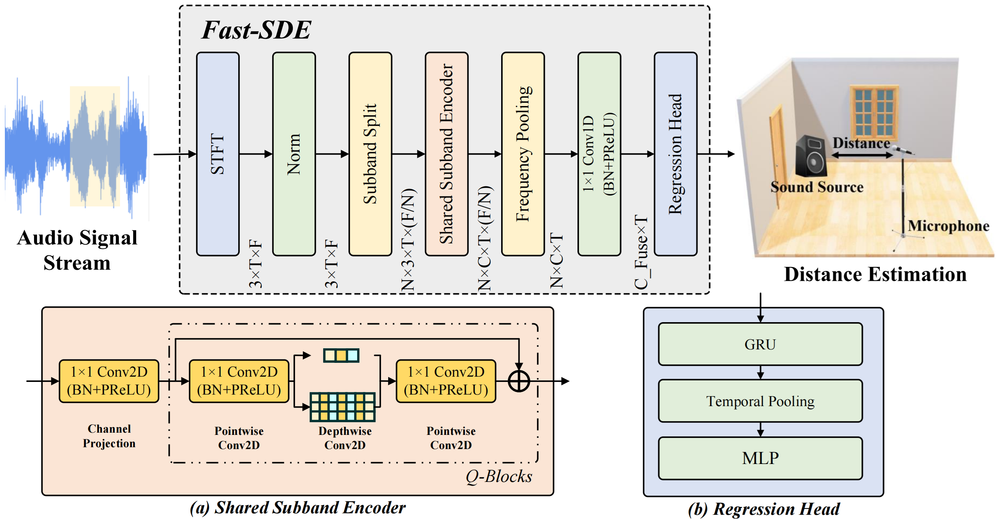

# Fast-SDE: Efficient Single-Microphone Sound Source Distance Estimation in Reverberant Environments

| Structure of the distance estimation neural network |
|---|
|<div align="center">| 

## Detailed Usage
#### Distance Estimations
```bash
# 1. Prepare simulation datasets by FRAM_RIR script (https://github.com/tencent-ailab/FRA-RIR)
python produce_RIR_1_room.py      # 1 room
# or
python produce_RIR_100_room.py    # 100 rooms 

# 2. Change the paths in the files under the foders of "chirp_signals", "configs"

# 3. Train the model with simulation dataset
python train_simu.py

# 4. Test the model with simulation dataset
python test_sim.py
```

#### Distance Estimations with real world datasets
```bash
# 1. Train the simulation model under 100 rooms

# 2. Fine tune the model with real world datasets
python train_real.py

# 3. Test the model with real world dataset
python test_real.py
```
## License
The source code and dataset are released under MIT license.

## Citation
Please, cite the paper if you use the codes or data for your research.

```bibtex
@article{wang2026fast,
  title={Fast-SDE: Efficient Single-Microphone Sound Source Distance Estimation in Reverberant Environments},
  author={Wang, Jiang and Shi, Runwu and Kang, Yaozhong and Yen, Benjamin and Ashizawa, Takeshi and Nakadai, Kazuhiro},
  journal={arXiv preprint arXiv:2606.12339},
  year={2026}
}
```
